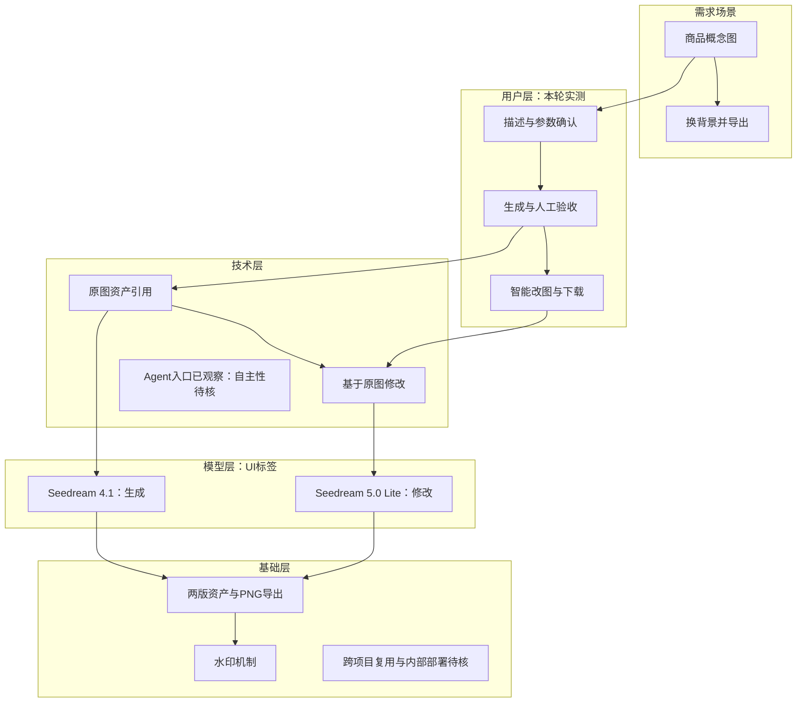

# 即梦 AI 产品拆解｜公开分享版

研究日期：2026-10-19。覆盖中国大陆网页端，完成单图生成、基于原图的一次背景修改及两版下载验收。本文发布规则与分析结果，不公开浏览器截图、账户记录、历史操作日志或原始产物。原始证据在研究者本地留存，读者无法通过本仓库独立复核全部操作。

## 1. 结论概览

即梦面向内容创作者、设计师与营销人员，把文字和参考素材转成可继续编辑的图片与视频，并通过多种创作模式承接视觉制作。这是研究归纳，不是实际用户构成统计。

本轮直接验证：中文提示词生成商品概念图，沿原图入口提出背景修改要求，得到第二版，并成功下载两版PNG。原图的银白饮料罐、石台、柑橘园与暖光基本符合要求；修改版实现蓝色摄影棚背景，罐体与石台大体保留。

修改并非像素锁定：反光和光照变化，左侧新增摄影棚支架。可以认定单案例修改有效，不能认定其他部分完全不变，亦不能外推复杂Logo或包装保真。

首页存在Agent模式和技能入口；本轮执行的是人工选定的图片生成、智能改图流程，没有让Agent自主拆解任务。不能将整站概括为纯Workflow，也不能证明自主规划或多Agent。

已确认：本轮生成、修改、下载闭环与UI呈现的模型标签。待核：视频、Agent自主性、复杂保真、稳定性和退款到账。

## 2. 范围与测试条件

| 项目 | 条件 |
|---|---|
| 产品端 | 中国大陆网页端，不混入App、海外Dreamina或API体验 |
| 入口 | [即梦工作台](https://jimeng.jianying.com/ai-tool/home/) |
| 版本 | 未取得网页构建号；按任务标签记录模型 |
| 图片生成 | Seedream 4.1，9:16、2K、单张 |
| 图片修改 | 原图详情→智能改图；页面选用Seedream 5.0 Lite，2K |
| 测试量 | 1次生成、1次修改、两版各下载一次 |
| 预算原则 | 不购买、不充值、不生成视频、不追加付费重试 |
| 计时 | 未精确计时，不报告平均速度或排队时间 |

早期另一会话曾显示Seedream 5.0 Pro，本轮实际任务是4.1与5.0 Lite。会话差异不能证明全站统一默认模型、后台降级或具体API版本。

## 3. 定位与市场位置

| 用户 | 需求场景 | 角色关系（研究假设） |
|---|---|---|
| 个人创作者 | 封面、插画、短视频素材 | 本人使用并验收 |
| 电商与品牌团队 | 商品场景图、广告概念 | 设计/运营使用，品牌负责人验收 |
| 影视与短剧团队 | 角色设定、镜头预演 | 创作者使用，导演/客户验收 |

以上是适配场景，不代表实际用户占比。即梦可比较的组合是生成、编辑和资产衔接。可灵和Vidu也有公开参考创作能力，不能只按“能生成”判断竞争领先。本次未做同任务横评或市场份额调查。

已确认：官方提供多类视觉创作入口。待核：真实用户构成、采购关系及竞品优劣。

## 4. 实测任务与验收

### T01：生成一张商品图

提示词：

> 一只无品牌的银白色饮料罐，正面单主体，放在浅色石台上，背景是清晨柑橘园，柔和暖光，简洁商业产品摄影，竖版，不出现文字或其他商品。

设置为Seedream 4.1、9:16、2K、数量1，避免使用原来的多张设置。结果可识别单罐、银白色、石台、柑橘园和暖光，没有商品文字或第二个商品。系统水印另行保留，不把“不出现文字”解释成去除系统标识。

### T02：基于原图只换背景

原图详情中进入智能改图，页面选用Seedream 5.0 Lite，原图被继承为参考，无需手动上传新图。

> 仅把背景改为浅蓝色室内摄影棚，保留原图银白色饮料罐的形状、大小、颜色和位置，保留浅色石台与竖版构图。不要添加文字或其他商品。

结果换成蓝色摄影棚，罐体与石台大体保留；反光、光照改变，左侧出现棚架。未追加修复，以遵守低额度约束。该任务同时模拟“不满意后修改”，不是第二个独立异常测试。

### 文件验收

| 文件 | 格式 | 实际尺寸 | 结果 |
|---|---|---|---|
| 原图 | PNG | 1440×2560 | 实际下载、解码和查看，与预览内容一致 |
| 修改图 | PNG | 1441×2559 | 实际下载、解码和查看，背景修改进入文件 |

两版保留“AI生成”和“即梦AI”水印。首次下载出现水印设置，保持去除开关关闭。修改版各边有约1像素差异，因此应以文件实际尺寸为准，不假定编辑前后精确尺寸恒定。

本轮验证了基础指令遵循、同图修改与交付有效性；未验证复杂文字包装、多次修改偏移、长期稳定性，未编造评分或成功率。

## 5. 用户旅程与异常

| 步骤 | 用户动作 | 实际反馈与确认点 |
|---|---|---|
| 入口 | 切换图片生成 | 出现当前模型与参数；不等于Agent执行 |
| 输入 | 写提示词，选择比例、清晰度和数量 | 提交前检查单位及单张设置 |
| 生成 | 提交一次 | 出现进度和最终产物，避免重复提交 |
| 验收 | 检查商品和背景 | 页面给出修改建议与编辑入口 |
| 修改 | 原图详情→智能改图 | 继承原图，使用不同模型及费用 |
| 下载 | 导出两版 | 首次水印设置；文件需实际打开检查 |

| 异常 | 本轮状态 |
|---|---|
| 不满意 | 通过同图换背景验证；与T02为同一案例 |
| 信息不全 | 未单独提交模糊要求，澄清能力未知 |
| 生成失败 | 两次任务成功；未制造失败，返还规则与到账未验证 |
| 中途改主意 | 未取消运行任务，取消恢复及收费未知 |

已确认：原版保留、定向修改与下载。待核：失败、取消和退费。

## 6. 人机分工与技术机制

| 步骤 | 人 | AI或固定程序 |
|---|---|---|
| 需求 | 确定主体、场景与预算 | 输入和参数界面 |
| 生成 | 选择模型、数量并提交 | 图像生成、任务状态和产物呈现 |
| 验收 | 判断是否可用 | 提供修改建议，不等于自动质检已证明 |
| 修改 | 指定偏差与保留项 | 基于原图进行智能改图 |
| 交付 | 下载并核对文件 | 导出和水印机制 |

可观察流程：人工提示词＋参数→Seedream 4.1→原图资产→人工修改要求＋原图引用→Seedream 5.0 Lite→第二版→下载。

这是界面层逻辑，不是后端调用日志。模型标签不证明精确权重、API ID、提示词、RAG或框架。原图引用支持任务内素材继承；跨对话记忆、项目同步与主体库复用未测。

已确认：人工主导的生成/改图流程和任务内引用。待核：Agent自主工具决策、跨项目上下文和内部实现。

## 7. 模型与经济账

| 步骤 | UI型号 | 本轮费用 | 边界 |
|---|---|---|---|
| 图片生成 | Seedream 4.1 | 1积分/张 | 单张，未横评其他型号 |
| 智能改图 | Seedream 5.0 Lite | 3积分/次 | 入口选用该型号；替换能力未测 |
| 合计 | 一次生成＋一次修改 | 4积分 | 不换算人民币，不代表任务免费 |
| 视频 | Seedance 2.0/2.5官方页面 | 未知 | 本轮未生成视频 |
| Agent理解 | 型号未核实 | 未知 | 不假定某款LLM或多Agent |

本轮费用预估与实际消耗记录相符；本公开版不提供账户明细。没有新增现金购买、去水印购买或额外重试。积分来源、套餐兑换条件未核实，不能据4积分倒推服务提供方成本或毛利。

官方会员活动中的订单退款规则不能替代任务失败退积分规则；本轮未做失败退款、取消收费或退款到账验证。当前会员价须以下单页为准，不把检索快照当实时价格。

已确认：本轮型号与总消耗。待核：实时套餐价、失败/取消、积分与现金退款边界。

## 8. 基础能力与壁垒

- 部分同源模型能力可通过API采购，接口可获取不等于模型研发壁垒消失。
- 从产物详情直接进入改图、继承原图并保留两版，支持单案例的流程整合价值。
- 通用算力、存储与队列可采购，本次没有确认具体供应商或部署。
- 社区入口存在，未证明规模、留存或网络效应。
- 公开协议涉及优化产品与模型的授权；授权文案不证明实际入训或效果提升。

已确认：本次任务内引用与版本保留。待核：跨项目资产复用、组织上下文、反馈积累。

## 9. 五层架构图

图中模块是解释性划分；不将界面行为当作服务端实现证明。

## 10. 优势、问题与改进

| 观察 | 可能原因（推断） | 建议 |
|---|---|---|
| 简短中文得到基本符合要求的概念图 | 能处理主体、场景和光线组合 | 适合初步构思；真实商品保真需另测 |
| 原图直接智能改图 | 任务与资产引用连接减少切换 | 明确显示引用版本 |
| 编辑切模型及单价 | 不同能力使用不同模型和计价 | 提交前展示型号与预计费用 |
| 背景改变伴随反光变化和棚架 | 生成式编辑可能重算部分画面 | 增强保留区域控制和差异对比 |
| 编辑前后导出尺寸略有变化 | 具体处理链未知 | 显示实际像素与目标尺寸适配 |

没有追加抽样挑更好结果，避免额外消耗和选择性呈现。

## 11. 二次核实与剩余问题

| 问题 | 最终状态 |
|---|---|
| 生成、修改、下载是否真正完成 | 已用任务结果和实际PNG核对完成 |
| 型号与费用 | 已确认本轮4.1、5.0 Lite及4积分总消耗 |
| 修改是否完全不改变主体 | 否；大体保留，不是像素锁定 |
| Agent或多Agent | 入口可见；自主执行和协作未验证 |
| 视频、长期稳定性 | 为节省额度未测，不外推 |
| 失败、取消和退款到账 | 未测；不能用会员订单规则替代 |
| 原始证据可否公开复核 | 本仓库未公开，需遵守研究者的分享范围 |

## 12. 来源与证据边界

本轮操作与文件证据由研究者本地保存，公开版只提供报告结论，不提供账户记录及截图。下面是可公开访问的产品和技术来源，不能替代本轮实测证据。

- [即梦官网](https://jimeng.jianying.com/)
- [AI生图指南](https://jimeng.jianying.com/tools/ai-image-generator)
- [Seedance 2.0介绍](https://jimeng.jianying.com/tools/seedance-2-0)
- [Seedance 2.5介绍](https://jimeng.jianying.com/tools/seedance-2-5)
- [会员活动页](https://jimeng.jianying.com/tools/jimeng-seedance-price)
- [同源API公开资料](https://developer.volcengine.com/articles/7546180861461266483)
- [Seedream 4.0研究](https://arxiv.org/abs/2509.20427)
- [Seedance 2.0研究](https://arxiv.org/abs/2604.14148)
- [可灵发布资料](https://ir.kuaishou.com/zh-hans/node/11216/pdf)
- [Vidu参考生视频](https://www.vidu.com/zh/ai-reference-to-video)

研究按本仓库[拆解规则](SKILL.md)执行。案例型号、价格和结论只适用于该次观察，不作为后续产品的默认事实。
